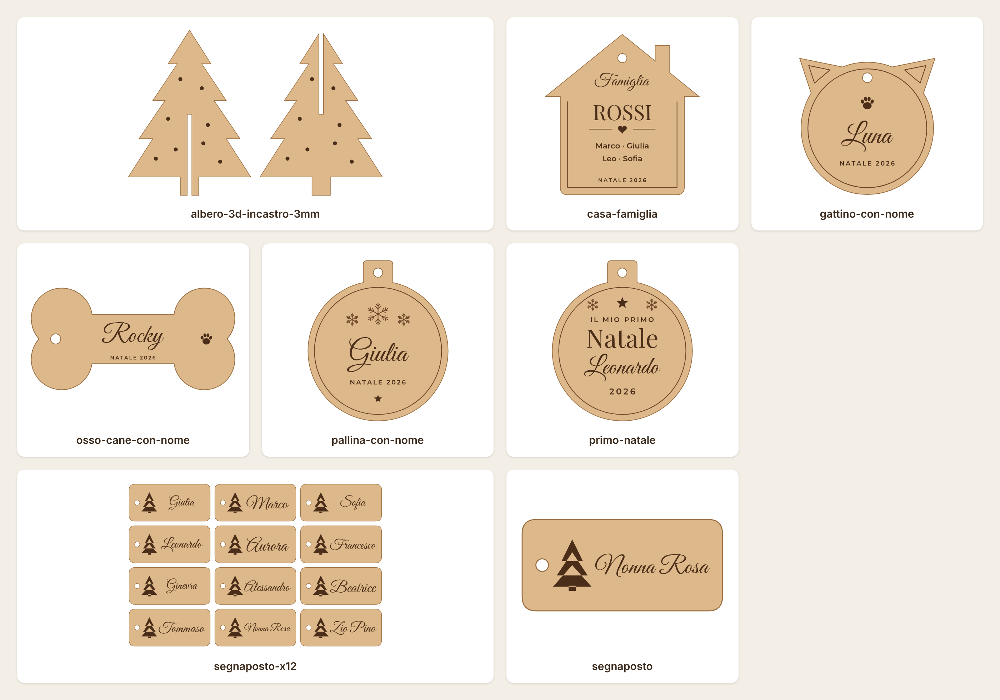

# File laser di Natale — INGLY DESIGN

Otto modelli originali per i regali di Natale più richiesti sui marketplace
come Etsy. Disegnati da zero per INGLY DESIGN, sono nostri: si possono
produrre e vendere.

La cartella inizia con `_`, quindi **non viene pubblicata sul sito**: i
file restano vostri.



## I modelli

| File | Cosa è | Misura | Si personalizza con |
|---|---|---|---|
| `pallina-con-nome.svg` | pallina con nome, fiocchi di neve e anno | 82 × 93 mm | nome, anno |
| `primo-natale.svg` | «Il mio primo Natale» per neonati | 82 × 93 mm | nome, anno |
| `casa-famiglia.svg` | casetta con cognome e nomi della famiglia | 84 × 94 mm | cognome, fino a 6 nomi, anno |
| `gattino-con-nome.svg` | testa di gatto con il nome | 80 × 88 mm | nome, anno |
| `osso-cane-con-nome.svg` | osso per il cane | 104 × 54 mm | nome, anno |
| `albero-3d-incastro-3mm.svg` | albero 3D a incastro, due pezzi | 172 × 112 mm | spessore del legno |
| `segnaposto.svg` | segnaposto / chiudipacco | 74 × 36 mm | nome |
| `segnaposto-x12.svg` | 12 segnaposto in un foglio | 226 × 148 mm | 12 nomi |

## Colori nel file

| Colore | Lavorazione |
|---|---|
| Rosso `#FF0000`, linea 0,1 mm | **Taglio** |
| Nero `#000000`, pieno | **Incisione** (riempimento) |
| Blu `#0000FF`, linea 0,2 mm | **Linea incisa** (bordo interno, fiocchi, orecchie) |

I livelli si chiamano `1-INCISIONE`, `2-LINEE` e `3-TAGLIO`: lavora in
quest'ordine. Nel taglio vanno prima i fori, poi la sagoma, così il pezzo
non si sposta.

Le scritte sono già tracciati uniti: non serve avere i font installati, e il
corsivo non lascia buchi dove le lettere si toccano.

## Materiale consigliato

- Compensato di pioppo o betulla da **3 mm** (l'albero 3D è calcolato su
  3 mm).
- Sulla superficie da incidere metti nastro di carta, o passa una mano di
  turapori dopo l'incisione, così le bruciature non macchiano il legno.
- I parametri di potenza e velocità dipendono dalla macchina e dal legno:
  fai sempre una prova su uno scarto.

## Personalizzare per un ordine

In **xTool Creative Space** apri il file e cancella la scritta di esempio.
Scrivi il nome con il font corsivo che preferisci, poi convertilo in
tracciato e saldalo («Weld»).

Oppure genera il file già pronto con il nome del cliente. Serve Node.js e,
la prima volta, `npm install` dentro questa cartella:

```bash
node genera.mjs pallina --nome "Aurora" --anno 2026
node genera.mjs primo-natale --nome "Edoardo"
node genera.mjs famiglia --cognome "Bianchi" --nomi "Luca,Sara,Matteo"
node genera.mjs gatto --nome "Briciola"
node genera.mjs osso --nome "Max"
node genera.mjs albero-3d --spessore 3.2      # misura il tuo compensato
node genera.mjs segnaposto --nome "Zia Anna"
node genera.mjs segnaposto-12 --nomi "Anna,Luca,Sara,..."
node genera.mjs esempi                        # rifà tutta la cartella esempi/
```

Con nomi lunghi la scritta si rimpicciolisce da sola per restare nello
spazio.

## Perché questi otto (ricerca del 20 novembre 2026)

Etsy non pubblica classifiche di vendita: le pagine dei prodotti e le guide
dei venditori sono indicazioni, non dati ufficiali. Ricorrono questi temi:

- **Palline e decorazioni in legno con nome o con il nome della famiglia**:
  il prodotto laser di Natale più presente in assoluto.
- **«Il mio primo Natale»**: vende soprattutto a novembre e dicembre, a
  genitori e parenti.
- **Animali** (cani e gatti con il nome): tra le raccolte con più
  recensioni.
- **Decorazioni 3D a incastro** (alberi, stelle): una tendenza in crescita.
- **Segnaposto e chiudipacco**: si vendono in quantità per il pranzo di
  Natale.

Altri temi forti, da valutare per i prossimi modelli: presepe e scritte di
fede, portacandele e lanterne, umorismo per adulti, e le decorazioni
«kawaii» a forma di raviolo, segnalate come tendenza 2026.

Fonti:
- [Etsy — Popular laser engraved ornaments](https://www.etsy.com/market/popular_laser_engraved_ornaments)
- [Etsy — Laser engraved ornaments](https://www.etsy.com/market/laser_engraved_ornaments)
- [Etsy — Christmas gift laser engraver 2026](https://www.etsy.com/market/christmas_gift_laser_engraver)
- [Atomm — Ornament ideas to sell on Etsy](https://www.atomm.com/blog/2762-ornament-ideas-to-sell-on-etsy)
- [Bonny Creations — Laser engraved ornaments to sell](https://www.bonnycreations.com/blog/laser-engraved-ornaments-to-sell)
- [xTool — Christmas ornaments to make and sell](https://www.xtool.com/blogs/business-ideas/christmas-ornaments-to-make-and-sell)
- [LaserSVGTemplates — 3D Christmas ornaments](https://lasersvgtemplates.com/blogs/news/%F0%9F%8E%84-3d-christmas-ornaments-premium-laser-cut-svg-files-for-stunning-holiday-decor)

## Font

Great Vibes, Playfair Display e Montserrat, con licenza SIL Open Font
License: si possono usare per prodotti in vendita.
